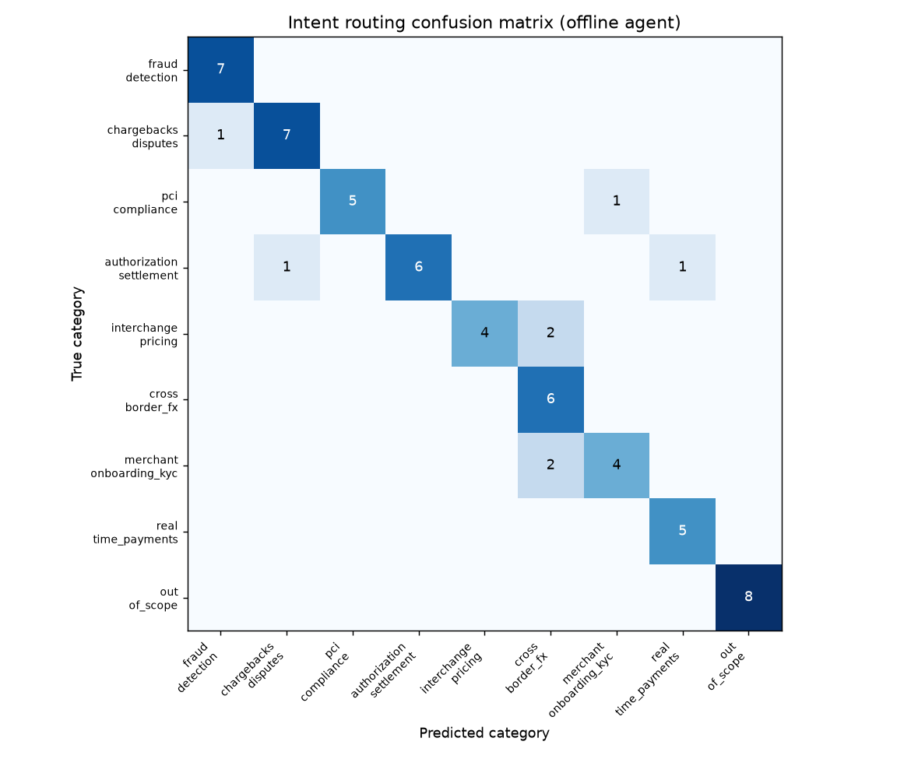

# Agentic RAG Demo — Payments Research Agent

A small, self-contained **agentic RAG** project for the **payments industry**. A research agent
answers questions about card fraud, chargebacks, PCI DSS, authorization & settlement, interchange,
cross-border FX, merchant onboarding/KYC and real-time payments by searching a **hybrid semantic
vector store** built from a **synthetic knowledge base** of a fictional processor, *NovaPay*.

The project ships with a **golden eval set, a confusion matrix, and threshold-gated tests**, so
quality is measured rather than eyeballed.

```
question ──► Research agent ──► semantic_search (hybrid TF-IDF + LSA, RRF fusion)
                 │   ▲              │
                 │   └── reformulate / filter by category / get_document
                 ▼
           submit_answer { answer, category, cited_doc_ids }  ──►  evals
```

## What's inside

| Path | What it is |
|---|---|
| `src/payrag/data_gen.py` | Synthetic corpus: 32 hand-written anchor docs (policies, runbooks, references) + 80 templated distractor docs (incident reports, merchant notes, tickets), 8 categories, deterministic by seed |
| `src/payrag/vector_store.py` | `LocalVectorStore`: TF-IDF (1–2-grams) + 96-dim LSA embeddings, Reciprocal Rank Fusion, category filters, persistence. Implements a small `VectorStore` protocol so a hosted vector DB can be swapped in |
| `src/payrag/tools.py` | Agent tools with strict JSON schemas: `semantic_search`, `get_document`, `submit_answer` |
| `src/payrag/agent.py` | `ClaudeResearchAgent` (Claude tool-use loop) and `OfflineResearchAgent` (deterministic multi-hop baseline, no API key needed) |
| `src/payrag/metrics.py` | Recall/Precision/Hit@k, MRR, nDCG, confusion matrix, per-class P/R/F1, fact recall, citation precision, groundedness |
| `src/payrag/evaluation.py` | Eval harness, threshold gate, Markdown/JSON/CSV/PNG reports |
| `evals/golden_set.jsonl` | 60 labelled questions: 52 in scope (expected category, relevant doc ids, required facts) + 8 out of scope |
| `evals/thresholds.json` | Quality gates per agent |
| `data/` | Generated sample vector data: `corpus.jsonl`, `vector_store/embeddings.npy`, `chunks.jsonl`, `manifest.json` |
| `reports/` | Latest eval report, confusion matrix (CSV + PNG), full per-question results |
| `tests/` | 30 pytest tests, including the end-to-end eval gate |

## Quick start

```bash
python -m venv .venv && source .venv/bin/activate
pip install -e ".[dev]"
payrag build-index                     # generate corpus + vector store
payrag search "visa 10.4 compelling evidence"
payrag ask --agent offline "When do merchants get paid out after capture?" --trace
payrag eval --agent offline            # writes reports/, exits 1 if a threshold fails
pytest -q
```

### Running the Claude agent

The LLM agent uses the Anthropic Python SDK (`claude-opus-5-5`, adaptive thinking, `effort=medium`,
server-side refusal fallback). It needs credentials (`ANTHROPIC_API_KEY` or `ant auth login`):

```bash
export ANTHROPIC_API_KEY=...
payrag ask "A cardholder disputed a forgotten subscription — how do we deflect that?"
payrag eval --agent claude --limit 10   # quick, cheaper smoke run (no threshold gate)
payrag eval --agent claude              # full golden set: 60 questions, several API calls each
```

`PAYRAG_MODEL` and `PAYRAG_EFFORT` override the model and effort level.

## How the agent works

**Claude agent** — a manual tool-use loop. Claude decides when to search, rewrites queries with
payments terminology, narrows by category, opens full documents, and ends by calling
`submit_answer` with a category (one of 8 topics or `out_of_scope`) and citations. All parallel tool
results are returned in a single message, tool errors are reported back as `is_error` results, and
the loop handles `refusal`, `max_tokens`, `pause_turn`, a missing `submit_answer` (one nudge), and a
step limit.

**Offline agent** — a deterministic baseline with the same output contract:
1. broad hybrid search;
2. relevance gate (keyword cosine + 0.25 × semantic cosine) → abstain as `out_of_scope` if weak;
3. route to a category by score-weighted vote of the top hits;
4. category-filtered re-search;
5. read the top 2 docs and extract the sentences with the highest IDF-weighted overlap.

## Evals

Each golden item has an expected **category**, **relevant doc ids** and **must-include facts**.
The harness measures:

| Dimension | Metrics |
|---|---|
| Retrieval | Recall@1/3/5, Precision@1/3/5, Hit@k, MRR, nDCG@5 |
| Intent routing | 9×9 **confusion matrix**, per-class precision/recall/F1, accuracy, macro & weighted F1 |
| Answer quality | Fact recall, exact-fact match rate, citation precision, groundedness (answer tokens supported by cited docs) |
| Abstention | Refusal recall/precision, false-refusal rate, binary confusion (should-refuse vs answered) |
| Efficiency | Mean tool calls, p50/p95 latency, error rate |

### Current results (offline baseline)

| Metric | Value | Gate |
|---|---|---|
| Recall@5 | 0.904 | ≥ 0.85 |
| MRR | 0.847 | ≥ 0.80 |
| nDCG@5 | 0.849 | ≥ 0.80 |
| Routing accuracy | 86.7% | ≥ 80% |
| Routing macro F1 | 0.862 | ≥ 0.80 |
| Fact recall | 0.692 | ≥ 0.65 |
| Citation precision | 0.683 | ≥ 0.65 |
| Groundedness | 1.000 | ≥ 0.95 |
| Out-of-scope refusal recall | 100% | ≥ 87.5% |
| False refusal rate | 0% | ≤ 5% |



The main confusions are interchange pricing ↔ cross-border FX (both talk about fees and markups)
and onboarding/KYC ↔ cross-border FX (sanctions screening vs. KYC). Full detail, including every
failing question, is in [`reports/offline_report.md`](reports/offline_report.md).

The `claude` gates in `evals/thresholds.json` are targets; run `payrag eval --agent claude` to
produce `reports/claude_report.md` and compare both agents on the same golden set.

### Caveats

* The corpus is synthetic. NovaPay and all of its thresholds, fees and SLAs are fictional;
  industry references (ISO 8583, ISO 20022, PCI DSS, Regulation II) are illustrative, not authoritative.
* The offline agent's relevance gate was calibrated on this golden set, so its abstention numbers are
  optimistic. Add a held-out question set before relying on them.
* Groundedness is a token-overlap proxy, not an LLM judge.

## Tests

```bash
pytest -q
```

* `test_metrics.py` – metric math against hand-computed values (incl. confusion matrix and F1).
* `test_vector_store.py` – exact-term and paraphrase retrieval, filters, persistence, embedding norms.
* `test_data_gen.py` – determinism, balance, and that every golden fact is really in its source doc.
* `test_agents.py` – offline agent behaviour; Claude loop against a fake client (request shape, single
  tool-result message, error reporting, nudge, refusal, step limit).
* `test_eval_gate.py` – runs the full eval and fails if any threshold regresses.

## CI

A GitHub Actions workflow that runs the tests and the offline eval gate is in
[`ci/github-actions-ci.yml`](ci/github-actions-ci.yml). To turn it on, move it to
`.github/workflows/ci.yml` (pushing workflow files needs a token with the `workflow` scope).
