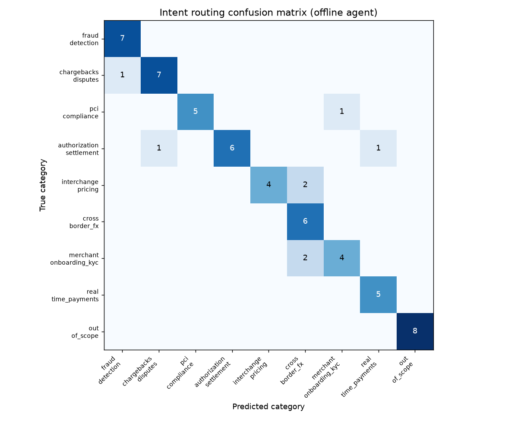

# Eval report: `offline` agent

Golden set: 60 questions (52 in scope, 8 out of scope).

**Threshold gate: PASS**

## Retrieval

| Metric | Value |
|---|---|
| recall@1 | 0.808 |
| recall@3 | 0.827 |
| recall@5 | 0.904 |
| precision@1 | 0.808 |
| precision@3 | 0.276 |
| precision@5 | 0.181 |
| hit@1 | 0.808 |
| hit@3 | 0.827 |
| hit@5 | 0.904 |
| mrr | 0.847 |
| ndcg@5 | 0.849 |

## Intent routing

Accuracy 86.7% · macro F1 0.862 · weighted F1 0.868

| Label | Precision | Recall | F1 | Support |
|---|---|---|---|---|
| fraud_detection | 0.88 | 1.00 | 0.93 | 7 |
| chargebacks_disputes | 0.88 | 0.88 | 0.88 | 8 |
| pci_compliance | 1.00 | 0.83 | 0.91 | 6 |
| authorization_settlement | 1.00 | 0.75 | 0.86 | 8 |
| interchange_pricing | 1.00 | 0.67 | 0.80 | 6 |
| cross_border_fx | 0.60 | 1.00 | 0.75 | 6 |
| merchant_onboarding_kyc | 0.80 | 0.67 | 0.73 | 6 |
| real_time_payments | 0.83 | 1.00 | 0.91 | 5 |
| out_of_scope | 1.00 | 1.00 | 1.00 | 8 |

### Confusion matrix (rows = true, columns = predicted)

| true \ pred | fraud_ | charge | pci_co | author | interc | cross_ | mercha | real_t | out_of |
|---|---|---|---|---|---|---|---|---|---|
| fraud_detection | 7 | · | · | · | · | · | · | · | · |
| chargebacks_disputes | 1 | 7 | · | · | · | · | · | · | · |
| pci_compliance | · | · | 5 | · | · | · | 1 | · | · |
| authorization_settlement | · | 1 | · | 6 | · | · | · | 1 | · |
| interchange_pricing | · | · | · | · | 4 | 2 | · | · | · |
| cross_border_fx | · | · | · | · | · | 6 | · | · | · |
| merchant_onboarding_kyc | · | · | · | · | · | 2 | 4 | · | · |
| real_time_payments | · | · | · | · | · | · | · | 5 | · |
| out_of_scope | · | · | · | · | · | · | · | · | 8 |

## Answer quality

| Metric | Value |
|---|---|
| fact_recall | 0.692 |
| citation_precision | 0.683 |
| groundedness | 1.000 |
| exact_fact_match_rate | 0.692 |

## Out-of-scope abstention

Refusal recall 100.0% · refusal precision 100.0% · false refusal rate 0.0% · {'tp': 8, 'fp': 0, 'fn': 0, 'tn': 52}

## Efficiency

| Metric | Value |
|---|---|
| mean_tool_calls | 3.567 |
| latency_p50_s | 0.001 |
| latency_p95_s | 0.001 |
| error_rate | 0.000 |

## Failures to inspect

- **q02** What happens to a transaction once it is flagged by the CNP velocity rules? — true `fraud_detection`, predicted `fraud_detection`, fact recall 0.00, retrieved ['FR-001', 'FRA-N001', 'FRA-N004']
- **q11** Which data elements must match the prior undisputed transactions for a card-absent fraud dispute? — true `chargebacks_disputes`, predicted `fraud_detection`, fact recall 0.00, retrieved ['FRA-N004', 'FRA-N003', 'FRA-N002']
- **q14** A customer disputed a subscription renewal they forgot about. How does NovaPay deflect this kind of friendly fraud? — true `chargebacks_disputes`, predicted `chargebacks_disputes`, fact recall 0.00, retrieved ['CB-004', 'CHA-N004', 'CHA-N005']
- **q18** Can we store the PAN in our application database? — true `pci_compliance`, predicted `merchant_onboarding_kyc`, fact recall 0.00, retrieved ['MER-N003', 'MER-N007', 'MER-N010']
- **q22** What does ISO 8583 message type 0100 mean? — true `authorization_settlement`, predicted `real_time_payments`, fact recall 0.00, retrieved ['RTP-002', 'REA-N003', 'REA-N008']
- **q27** Can a hotel increase the amount held on a guest's card? — true `authorization_settlement`, predicted `chargebacks_disputes`, fact recall 0.00, retrieved ['CHA-N007', 'CHA-N009', 'CB-003']
- **q31** What is NovaPay's standard markup on IC++? — true `interchange_pricing`, predicted `cross_border_fx`, fact recall 0.00, retrieved ['FX-001', 'FX-003', 'FX-002']
- **q32** What is the Durbin regulated debit interchange cap? — true `interchange_pricing`, predicted `interchange_pricing`, fact recall 0.00, retrieved ['IP-002', 'INT-N006', 'IP-001']
- **q34** What is the flat rate on the NovaPay Starter plan? — true `interchange_pricing`, predicted `cross_border_fx`, fact recall 0.00, retrieved ['CRO-N004', 'CRO-N009', 'CRO-N007']
- **q36** What is the maximum markup allowed for dynamic currency conversion? — true `cross_border_fx`, predicted `cross_border_fx`, fact recall 0.00, retrieved ['FX-001', 'CRO-N002', 'FX-002']
- **q37** Can DCC be pre-selected for a foreign cardholder at the point of sale? — true `cross_border_fx`, predicted `cross_border_fx`, fact recall 0.00, retrieved ['FX-001', 'CRO-N009', 'CRO-N008']
- **q42** Which MCCs are treated as high risk during underwriting? — true `merchant_onboarding_kyc`, predicted `cross_border_fx`, fact recall 0.00, retrieved ['CRO-N010', 'FX-003', 'KYC-001']
- **q43** How large is the rolling reserve for high-risk merchants and how long is it held? — true `merchant_onboarding_kyc`, predicted `cross_border_fx`, fact recall 0.00, retrieved ['CRO-N010', 'CRO-N009', 'CRO-N008']
- **q44** What ownership percentage makes someone a beneficial owner we must verify? — true `merchant_onboarding_kyc`, predicted `merchant_onboarding_kyc`, fact recall 0.00, retrieved ['MER-N005', 'MER-N002', 'MER-N009']
- **q49** What is the per-transaction cap on instant payouts? — true `real_time_payments`, predicted `real_time_payments`, fact recall 0.00, retrieved ['REA-N001', 'REA-N007', 'REA-N008']
- **q51** How do we protect instant payouts from authorized push payment scams? — true `real_time_payments`, predicted `real_time_payments`, fact recall 0.00, retrieved ['RTP-003', 'REA-N001', 'REA-N007']
